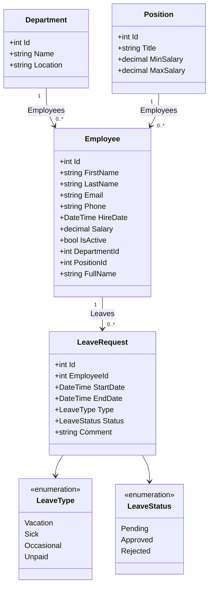

# HR System – system zarządzania pracownikami

**Autor:** [Imię i nazwisko]
**Przedmiot:** [nazwa przedmiotu], [grupa]
**Repozytorium Git:** [link do repozytorium]

## 1. Wprowadzenie

Aplikacja wspiera dział kadr w małej i średniej firmie. Pozwala prowadzić ewidencję pracowników, działów i stanowisk oraz obsługiwać wnioski urlopowe wraz z ich zatwierdzaniem. Dodatkowo udostępnia zestawienia statystyczne (zatrudnienie, płace, wykorzystanie urlopów).

Technologie: ASP.NET Core MVC (.NET 8), Entity Framework Core (Code First), SQL Server LocalDB, LINQ, Bootstrap 5.

## 2. Podział prac

Projekt wykonany indywidualnie.

## 3. Model danych

Cztery encje powiązane właściwościami nawigacyjnymi:

- **Department** (dział) – 1 : N z Employee,
- **Position** (stanowisko, z widełkami płacowymi) – 1 : N z Employee,
- **Employee** (pracownik) – 1 : N z LeaveRequest,
- **LeaveRequest** (wniosek urlopowy) – rodzaj i status jako typy wyliczeniowe.

### Diagram klas

Diagram możesz wyrenderować w edytorze obsługującym Mermaid (np. mermaid.live) i wkleić jako obrazek.

## 4. Spis funkcjonalności

**Pracownicy**
- pełny CRUD (lista, szczegóły, dodawanie, edycja, usuwanie),
- wyszukiwanie po imieniu, nazwisku i e-mailu,
- filtrowanie po dziale,
- sortowanie po nazwisku, dacie zatrudnienia i wynagrodzeniu (rosnąco/malejąco),
- stronicowanie (8 pozycji na stronę),
- walidacja: wynagrodzenie w widełkach stanowiska,
- szczegóły z działem, stanowiskiem i historią wniosków urlopowych.

**Działy** – lista, szczegóły z listą pracowników i podsumowaniem płac, dodawanie, edycja.

**Stanowiska** – lista z widełkami i przypisanymi pracownikami, dodawanie.

**Urlopy** – składanie wniosku (także prosto z karty pracownika), filtrowanie po statusie, zatwierdzanie i odrzucanie; walidacja: data końcowa nie wcześniejsza niż początkowa, brak nakładania się wniosków.

**Statystyki** – liczba aktywnych pracowników, fundusz płac, średnie wynagrodzenie, zestawienie według działów, zatrudnienia według lat, wnioski urlopowe według statusu.

**Nawigacja** – nazwy pracowników, działów i stanowisk są linkami do szczegółów w każdym widoku; menu główne z podświetleniem bieżącej sekcji.

## 5. Najciekawsze elementy aplikacji

Wstaw zrzuty ekranu po uruchomieniu aplikacji i dopisz po 1–2 zdania opisu:

| Zrzut ekranu | Opis |
|---|---|
| [lista pracowników z filtrem i stronicowaniem] | Wyszukiwanie, filtr działu, sortowanie przez nagłówki kolumn, pager. |
| [szczegóły działu] | Lista pracowników działu z linkami oraz statystyki płac. |
| [formularz pracownika z błędem walidacji] | Kontrola widełek płacowych stanowiska. |
| [wnioski urlopowe] | Filtr statusów oraz zatwierdzanie i odrzucanie wniosków. |
| [statystyki] | Zestawienia według działów, lat zatrudnienia i statusów wniosków. |

## 6. Uruchomienie

Instrukcja w pliku `README.md`.
